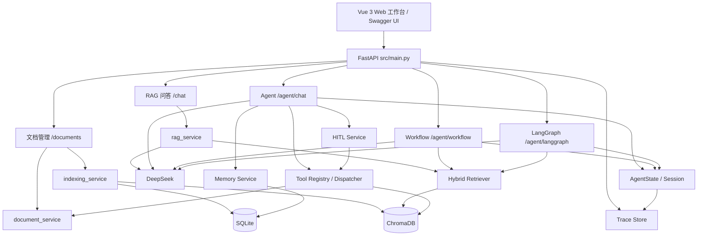

# Local Knowledge Base

一个面向本地知识库的 RAG + Agent 工程化项目，支持 Markdown 文档管理、双存储索引、DeepSeek 问答、工具调用、Workflow、LangGraph、Memory、Human-in-the-loop 与可观测性。

项目不仅提供后端 API，还包含 Vue 3 Web 工作台，可用于本地演示、源码学习和 Agent 开发面试讲解。

## 核心能力

- **RAG 问答**：Markdown 文档加载、切分、Embedding、混合检索和 DeepSeek 生成。
- **文档生命周期**：上传、列表、详情、更新、删除，并同步维护 SQLite 与 ChromaDB。
- **Agent 工具调用**：模型可自主调用知识库检索、文档列表、文档详情等工具。
- **手写 Workflow**：节点定义、条件路由、有限补充检索和失败处理。
- **LangGraph 对照实现**：保留手写 Workflow，同时提供 LangGraph 版本。
- **Memory**：短期会话历史裁剪 + SQLite 长期记忆读写与检索。
- **Human-in-the-loop**：高风险工具需人工批准、拒绝或修改参数后执行。
- **可观测性**：Trace 记录、失败分析、评估和回归测试。
- **Web 工作台**：Dashboard、Knowledge Base、AI Assistant、Agent Workflow、Approval Center、Trace Monitor。

## 技术栈

- Python 3.12 ARM64
- FastAPI / Uvicorn
- SQLite
- ChromaDB
- Sentence Transformers / `BAAI/bge-small-zh-v1.5`
- DeepSeek Chat Completions
- LangGraph
- Vue 3 / TypeScript / Vite / Element Plus / Pinia

## 系统架构



## 目录结构

```text
.
├── frontend/               # Vue 3 Web 工作台
├── src/
│   ├── agent/              # Agent、AgentState、Session、Workflow、LangGraph
│   ├── database/           # SQLite 数据访问
│   ├── hitl/               # Human-in-the-loop
│   ├── memory/             # 短期与长期记忆
│   ├── observability/      # Trace、评估、失败分析
│   ├── rag/                # 文档加载、切分、Embedding、检索、LLM
│   ├── services/           # 文档与索引服务
│   ├── tools/              # 工具注册与分发
│   ├── config.py           # 配置管理
│   └── main.py             # FastAPI 入口
├── tests/                  # 单元测试与集成测试
├── docs/                   # 架构、验收与已知限制
├── scripts/                # 演示脚本
├── .env.example            # 环境变量示例
└── requirements.txt        # Python 依赖
```

## 快速开始

### 环境要求

- macOS Apple Silicon（ARM64）
- Python 3.12 ARM64
- Node.js 18+，建议 20+
- 可用的 DeepSeek API Key
- 本地或可下载的 `BAAI/bge-small-zh-v1.5` Embedding 模型

### 1. 启动后端

```bash
python3.12 -m venv .venv
source .venv/bin/activate
pip install -r requirements.txt
cp .env.example .env
```

编辑 `.env`，至少填写：

```bash
DEEPSEEK_API_KEY=your-deepseek-api-key
```

如果本机尚未缓存 Embedding 模型，可先下载一次：

```bash
python -c "from sentence_transformers import SentenceTransformer; SentenceTransformer('BAAI/bge-small-zh-v1.5')"
```

随后启动服务：

```bash
uvicorn src.main:app --reload
```

访问地址：

- Swagger UI：`http://127.0.0.1:8000/docs`
- 健康检查：`http://127.0.0.1:8000/health`

### 2. 启动前端

```bash
cd frontend
npm ci
npm run dev
```

前端默认运行在 `http://127.0.0.1:5173`，Vite 会将 `/api` 代理到 `http://127.0.0.1:8000`。

生产构建：

```bash
cd frontend
npm run build
```

## 环境变量

完整示例见 `.env.example`。

| 变量 | 必填 | 默认值 | 说明 |
| --- | --- | --- | --- |
| `DEEPSEEK_API_KEY` | 是 | 无 | DeepSeek API Key |
| `DEEPSEEK_MODEL` | 否 | `deepseek-chat` | 生成模型 |
| `DEEPSEEK_API_URL` | 否 | `https://api.deepseek.com/chat/completions` | DeepSeek API 地址 |
| `EMBEDDING_MODEL_NAME` | 否 | `BAAI/bge-small-zh-v1.5` | Embedding 模型 |
| `EMBEDDING_LOCAL_FILES_ONLY` | 否 | `true` | 是否只使用本地模型文件 |
| `MIN_SIMILARITY` | 否 | `0.60` | 最低相似度阈值 |
| `TOP_K` | 否 | `3` | 默认检索数量 |
| `CHUNK_SIZE` | 否 | `200` | Chunk 大小 |
| `CHUNK_OVERLAP` | 否 | `40` | Chunk 重叠长度 |
| `AGENT_MAX_TOOL_CALLS` | 否 | `5` | Agent 单轮最大工具调用次数 |
| `APP_LOG_LEVEL` | 否 | `INFO` | 日志级别 |
| `APP_LOG_FORMAT` | 否 | 见示例 | 日志格式 |

## Web 工作台

| 路由 | 页面 | 说明 |
| --- | --- | --- |
| `/dashboard` | Dashboard | 系统状态、文档统计、最近 Trace、待审批数量 |
| `/knowledge-base` | Knowledge Base | Markdown 上传、列表、详情、更新、删除 |
| `/assistant` | AI Assistant | RAG、Agent、Workflow、LangGraph 多模式对话 |
| `/workflow` | Agent Workflow | 手写 Workflow 与 LangGraph 执行轨迹 |
| `/approval` | Approval Center | HITL 待确认操作审批 |
| `/trace` | Trace Monitor | Trace 列表、详情与失败分析 |

## API 概览

| 方法 | 路径 | 说明 |
| --- | --- | --- |
| `POST` | `/chat` | RAG 知识库问答 |
| `POST` | `/agent/chat` | Agent 问答，可自主调用工具 |
| `POST` | `/agent/workflow` | 手写 Workflow 执行 |
| `POST` | `/agent/langgraph` | LangGraph Workflow 执行 |
| `POST` | `/documents` | 上传 Markdown 文档 |
| `GET` | `/documents` | 文档列表 |
| `GET` | `/documents/{id}` | 文档详情与 Chunk |
| `PUT` | `/documents/{id}` | 更新文档并重新索引 |
| `DELETE` | `/documents/{id}` | 删除文档及双存储数据 |
| `GET` | `/agent/confirmations` | 待确认操作列表 |
| `POST` | `/agent/confirmations/{id}/approve` | 批准操作 |
| `POST` | `/agent/confirmations/{id}/modify` | 修改操作参数 |
| `POST` | `/agent/confirmations/{id}/reject` | 拒绝操作 |
| `GET` | `/agent/traces` | Trace 列表 |
| `GET` | `/agent/traces/{trace_id}` | Trace 详情 |
| `GET` | `/agent/traces/{trace_id}/analysis` | Trace 失败分析 |

示例：

```bash
curl -X POST http://127.0.0.1:8000/chat \
  -H 'Content-Type: application/json' \
  -d '{"question":"什么是 RAG？"}'
```

## 测试

不依赖真实模型和外部 API 的回归门禁：

```bash
python run_tests.py

python run_tests.py --category unit
python run_tests.py --category integration
python run_tests.py --category regression
```

真实数据冒烟与验收：

```bash
# 检查真实 SQLite 与 ChromaDB 一致性
python -m tests.test_indexing_service --verify

# 从 data/documents 重新构建并同步索引
python -m tests.test_indexing_service --real

# 查看真实 SQLite 与 ChromaDB 的文档和 Chunk 数量
python -m tests.test_storage_status
```

测试矩阵见 `TEST_MATRIX.md`。

## 数据与持久化

- Markdown 文件是原始内容来源。
- SQLite 管理文档记录、Chunk 内容和元数据。
- ChromaDB 保存向量索引，可从 Markdown 重新生成 Embedding 重建。
- 文档更新和删除采用补偿机制，失败时尝试恢复文件与数据库状态。
- Memory 长期记忆持久化在 SQLite。
- Trace、HITL 待确认操作和 Agent Session 当前为进程内存储，服务重启后丢失。

持久化边界见 `PERSISTENCE_MATRIX.md`。

## 演示

```bash
# 离线验收演示，不依赖真实 DeepSeek
python scripts/demo_acceptance.py

# 真实服务演示，需先启动 Uvicorn 并配置 DeepSeek
./scripts/demo_live.sh
```

## 已知限制

- 当前只支持 Markdown，不支持 PDF、Word、HTML。
- Trace、HITL、Agent Session 为进程内存储。
- SQLite 与 ChromaDB 是补偿机制，不是跨数据库强一致事务。
- 长期记忆目前使用关键词/BM25 检索，尚未向量化。
- 尚未实现用户认证、多租户和细粒度权限。
- 当前面向本地小规模知识库，未做分布式索引或异步任务队列。

详细说明见 `docs/known_issues.md`。

## 文档

- 系统架构：`docs/architecture.md`
- 验收报告：`docs/acceptance_report.md`
- 已知限制：`docs/known_issues.md`
- 测试矩阵：`TEST_MATRIX.md`
- 持久化边界：`PERSISTENCE_MATRIX.md`

## Roadmap

- 为 Trace 和 HITL 增加 SQLite 持久化。
- 为高风险工具增加执行幂等记录。
- 增加用户认证、多租户和工具权限。
- 扩展 PDF、Word 等文档格式。
- 引入 Rerank 和向量化长期记忆。
- 增加前端 E2E 测试和 CI。
