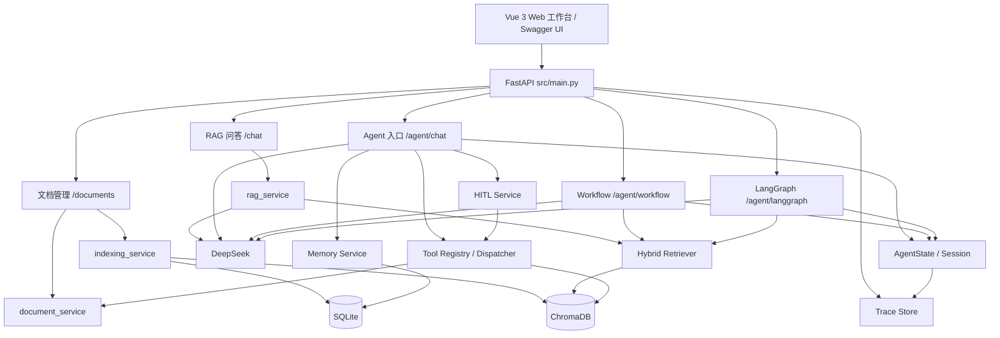
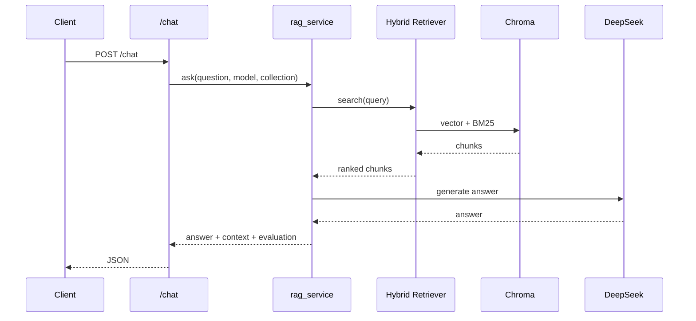
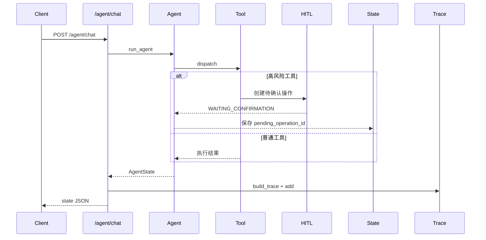

# 系统架构

## 总览



## 分层职责

| 层 | 模块 | 职责 |
| --- | --- | --- |
| 展示层 | `frontend/` | Vue 3 + Element Plus，六页知识库 Agent 工作台。 |
| 接入层 | `src/main.py` | 路由、统一异常处理、应用生命周期。 |
| 执行层 | `src/agent/agent.py` | Agent Loop、工具调用循环、状态更新。 |
| 执行层 | `src/agent/workflow.py` | 手写节点、条件路由和有限循环。 |
| 执行层 | `src/agent/langgraph_workflow.py` | LangGraph 对照实现。 |
| 能力层 | `src/services/rag_service.py` | RAG 检索、生成和评估编排。 |
| 能力层 | `src/tools/` | 工具注册、参数校验、执行分发。 |
| 能力层 | `src/hitl/` | 高风险操作确认、批准、拒绝和超时。 |
| 能力层 | `src/memory/` | 短期历史裁剪和长期记忆存取。 |
| 数据层 | `src/database/db.py` | SQLite 文档、Chunk、Memory。 |
| 数据层 | `src/rag/vector_store.py` | ChromaDB 向量持久化。 |
| 外部依赖 | `src/rag/llm.py`、`src/rag/embedder.py` | DeepSeek 生成、本地 Embedding。 |

## 关键链路

### 知识库问答



### Agent 工具调用



## 目录结构

```text
src/
├── agent/          # Agent、State、Workflow、LangGraph
├── database/       # SQLite
├── errors.py       # 业务异常
├── hitl/           # Human-in-the-loop
├── memory/         # 短期与长期记忆
├── observability/  # Trace、评估、失败分析
├── rag/            # 文档、切分、Embedding、检索、LLM
├── services/       # 文档与索引服务
└── tools/          # 工具注册与分发
```
